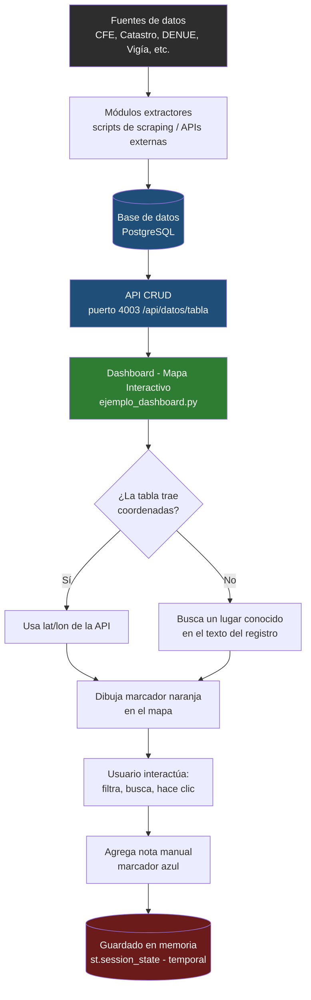

# Diagrama de flujo del proyecto Extracción de Datos Geográficos (Ensenada)

Este diagrama muestra el flujo general de datos del proyecto, desde la extracción hasta el componente del mapa interactivo.

**Nota:** el recuadro rojo (`st.session_state`) indica que, por ahora, las notas agregadas con clic solo viven en memoria mientras la app está abierta guardarlas de forma permanente en la base de datos queda como trabajo futuro (ver `DESIGN_DOC.md`, sección *Non-Goals*).
